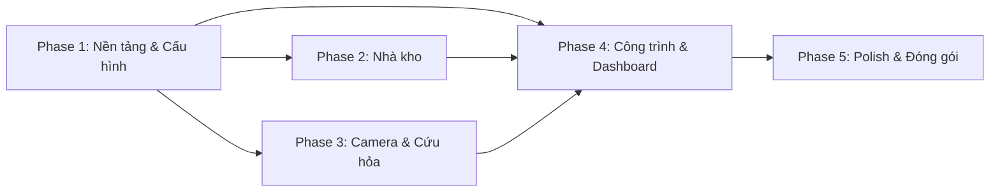

# Kế Hoạch Triển Khai - Warehouse Management (Electron)

## Stack Công Nghệ

| Tầng | Công nghệ |
|---|---|
| **Frontend** | HTML + CSS + Vanilla JavaScript |
| **Runtime** | Electron |
| **Database** | SQLite (better-sqlite3) |
| **Build/Package** | electron-builder → `.exe` installer |
| **Font** | Inter (Google Fonts, bundle offline) |
| **Icons** | Lucide Icons |

---

## Phase 1 — Nền tảng & Cấu hình

> [!IMPORTANT]
> Phase này phải hoàn thành trước khi làm bất kỳ module nghiệp vụ nào, vì các module đều phụ thuộc vào dữ liệu danh mục.

### Task 1.1: Khởi tạo dự án Electron
- [ ] Khởi tạo `package.json`, cài `electron`, `better-sqlite3`, `electron-builder`
- [ ] Tạo `main.js` (main process) — cửa sổ chính, menu, tray
- [ ] Tạo `preload.js` — expose API an toàn qua `contextBridge`
- [ ] Tạo cấu trúc thư mục chuẩn:
```
src/
├── main/           # Electron main process
│   ├── main.js
│   ├── preload.js
│   └── database/
│       ├── db.js           # Khởi tạo SQLite connection
│       ├── migrations.js   # Tạo bảng, seed data
│       └── queries/        # Các hàm query theo module
│           ├── units.js
│           ├── locations.js
│           ├── warehouses.js
│           └── cameras.js
├── renderer/       # Frontend (HTML/CSS/JS)
│   ├── index.html
│   ├── css/
│   │   ├── variables.css
│   │   ├── layout.css
│   │   ├── components.css
│   │   └── modules/
│   ├── js/
│   │   ├── app.js          # Router, khởi tạo
│   │   ├── components/     # UI components tái sử dụng
│   │   └── modules/        # Logic theo module
│   └── assets/
│       ├── fonts/
│       └── icons/
```

### Task 1.2: Thiết kế & tạo Database (SQLite)
- [ ] Bảng `units` — Phân cấp đơn vị (cây đa cấp, self-reference)
- [ ] Bảng `provinces` — Danh sách tỉnh
- [ ] Bảng `wards` — Danh sách xã (FK → provinces)
- [ ] Bảng `warehouse_types` — Loại nhà kho
- [ ] Bảng `goods_types` — Loại hàng
- [ ] Bảng `quality_grades` — Phân cấp chất lượng
- [ ] Bảng `warehouses` — Nhà kho (18 trường, FK → các bảng danh mục)
- [ ] Bảng `cameras` — Camera an ninh (14 trường)
- [ ] Seed data mẫu cho danh mục

### Task 1.3: Design System (CSS)
- [ ] `variables.css` — Color tokens, spacing, typography, shadows
- [ ] `layout.css` — Sidebar + Header + Main content grid
- [ ] `components.css` — Button, Input, Select, Table, Card, Modal, Tree, Badge, Toast

### Task 1.4: Layout chính & Navigation
- [ ] Header: Logo, tên phần mềm, search box, user avatar
- [ ] Sidebar: Menu 6 mục với icons, trạng thái active
- [ ] Main content: Container có transition khi chuyển tab
- [ ] Router đơn giản (JS) — chuyển nội dung theo menu click

### Task 1.5: Module Cấu hình
- [ ] Sub-tab: **Phân cấp đơn vị** — CRUD + hiển thị dạng tree
- [ ] Sub-tab: **Địa phương** — Quản lý tỉnh + xã (cascade), nhập tay + import từ Excel
- [ ] Sub-tab: **Loại nhà kho** — CRUD danh mục
- [ ] Sub-tab: **Loại hàng** — CRUD danh mục
- [ ] Sub-tab: **Phân cấp chất lượng** — CRUD danh mục
- [ ] Sub-tab: **Hệ thống chống sét** — CRUD danh mục

---

## Phase 2 — Module Quản Lý Nhà Kho

### Task 2.1: Form nhập liệu nhà kho
- [ ] Layout form dạng grid (2–3 cột)
- [ ] Các trường text input: Tên kho, Số lượng, Diện tích, Năm xây dựng...
- [ ] Combobox cascade: Đơn vị cha → Đơn vị con
- [ ] Combobox cascade: Tỉnh → Xã
- [ ] Combobox đơn: Loại nhà kho, Loại hàng, Phân cấp chất lượng
- [ ] Group "Hệ thống cứu hỏa": Nhu cầu + Hiện có
- [ ] Validation: required fields, number range, năm hợp lệ

### Task 2.2: CRUD Operations (Nhà kho)
- [ ] **Create** — Insert mới + toast thông báo
- [ ] **Read** — Load danh sách + populate form khi chọn
- [ ] **Update** — Sửa record + confirm dialog
- [ ] **Delete** — Xóa record + confirm dialog

### Task 2.3: Danh sách nhà kho (Tree/Table view)
- [ ] Hiển thị phân cấp theo đơn vị (tree view, expand/collapse)
- [ ] Cột hiển thị: Tên kho, Đơn vị, Địa điểm, Loại, Chất lượng, Trạng thái
- [ ] Click row → load dữ liệu vào form
- [ ] Tìm kiếm / lọc theo tên, đơn vị, loại kho

---

## Phase 3 — Module Camera & Cứu Hỏa

### Task 3.1: Module Camera An Ninh
- [ ] Form nhập liệu (cấu trúc giống module kho)
- [ ] Các combobox: Đơn vị cha/con, Đơn vị tính, Cơ quan đầu tư
- [ ] Group "Nhu cầu": Sửa chữa lắp đặt + Lắp đặt mới
- [ ] CRUD operations
- [ ] Danh sách dạng tree/table phân cấp

### Task 3.2: Module Cứu Hỏa
- [ ] Tạo **Excel template mẫu** cho module cứu hỏa (định dạng cột, validation, ví dụ)
- [ ] Form nhập liệu (trường dữ liệu dựa trên template)
- [ ] CRUD operations
- [ ] Danh sách phân cấp

---

## Phase 4 — Module Công Trình & Dashboard

### Task 4.1: Module Công Trình Xây Mới / Nâng Cấp
- [ ] Tạo **Excel template mẫu** cho module công trình (định dạng cột, validation, ví dụ)
- [ ] Form nhập liệu (trường dữ liệu dựa trên template)
- [ ] CRUD operations
- [ ] Danh sách phân cấp

### Task 4.2: Dashboard
- [ ] **Stat Cards**: Tổng nhà kho, tổng camera, tổng công trình, cảnh báo
- [ ] **Biểu đồ**: Phân bổ kho theo đơn vị (bar chart)
- [ ] **Biểu đồ**: Chất lượng kho (pie/donut chart)
- [ ] **Biểu đồ**: Tình trạng camera (stacked bar)
- [ ] **Danh sách nhanh**: Kho cần sửa chữa, camera hỏng
- [ ] Search box tìm kiếm toàn hệ thống

---

## Phase 5 — Polish & Đóng gói

### Task 5.1: UX Polish
- [ ] Micro-animations (sidebar hover, page transition, toast slide)
- [ ] Loading states cho các thao tác DB
- [ ] Keyboard shortcuts (Ctrl+N tạo mới, Ctrl+S lưu, Esc hủy)
- [ ] Responsive sidebar (collapse trên màn hình nhỏ)

### Task 5.2: Import / Export Excel & Báo cáo
- [ ] **Import Excel** — đọc file `.xlsx`, validate dữ liệu, hiển thị preview trước khi lưu
- [ ] **Export Excel** — xuất danh sách nhà kho, camera, cứu hỏa, công trình → `.xlsx`
- [ ] **Download template mẫu** — user tải file Excel mẫu đúng format để nhập liệu
- [ ] In báo cáo tổng hợp (print-friendly CSS)

### Task 5.3: Đóng gói Desktop
- [ ] Cấu hình `electron-builder` → `.exe` installer
- [ ] App icon, splash screen
- [ ] Auto-update mechanism (optional)
- [ ] Test trên Windows 10/11

---

## Sơ đồ phụ thuộc giữa các Phase



> [!NOTE]
> Phase 2 và Phase 3 có thể triển khai **song song** vì chúng độc lập nhau.
> Phase 4 (Dashboard) cần dữ liệu từ Phase 2 + 3 để tổng hợp thống kê.

---

## Câu hỏi cần làm rõ trước khi bắt đầu

| # | Câu hỏi | Trả lời |
|---|---|---|
| 1 | File Excel mẫu cho module **Cứu hỏa** và **Công trình** đã có chưa? | ✅ Tạo Excel template mẫu để user nhập đúng format |
| 2 | Danh sách tỉnh/xã cần nhập sẵn hay để user tự nhập? | ✅ Vừa nhập tay (sửa) + import từ Excel |
| 3 | Có cần export/import dữ liệu từ Excel không? | ✅ Có — import + export cho tất cả module |
