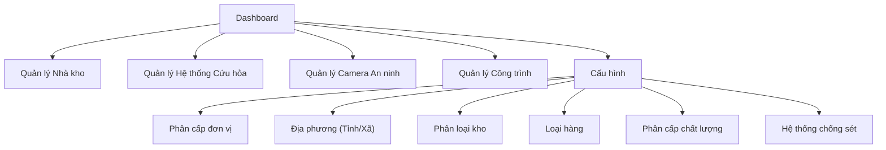
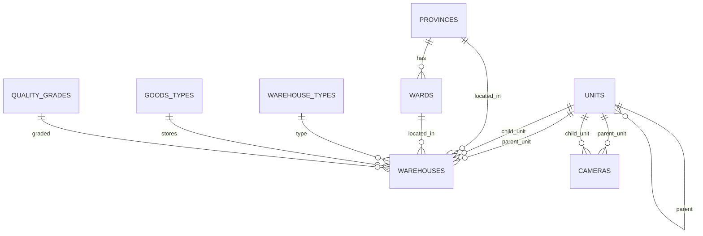

# Phân Tích Hệ Thống - Warehouse Management

## 1. Tổng Quan Hệ Thống

| Thuộc tính | Giá trị |
|---|---|
| **Tên** | Phần mềm quản lý nhà kho (Warehouse Management) |
| **Loại** | Web App (desktop app) có CSDL |
| **Người dùng** | Đơn người dùng, tài khoản cố định `admin` |
| **Phạm vi** | Quản lý kho, camera, cứu hỏa, công trình xây dựng |

## 2. Kiến Trúc Module



## 3. Cấu Trúc Dữ Liệu

### 3.1 Bảng `warehouses` (Nhà kho)

| Trường | Kiểu | Mô tả |
|---|---|---|
| `id` | INT (PK, auto) | ID nhà kho (ẩn) |
| `name` | TEXT | Tên kho |
| `parent_unit_id` | FK → units | Đơn vị cha |
| `child_unit_id` | FK → units | Đơn vị con |
| `province_id` | FK → provinces | Tỉnh |
| `ward_id` | FK → wards | Xã (lọc theo tỉnh) |
| `quantity` | INT | Số lượng |
| `land_area` | FLOAT | Diện tích chiếm đất |
| `warehouse_area` | FLOAT | Diện tích nhà kho |
| `year_built` | INT | Năm xây dựng |
| `year_renovated` | INT | Năm sửa chữa/nâng cấp |
| `warehouse_type_id` | FK → warehouse_types | Loại nhà kho |
| `storage_capacity` | FLOAT | Khả năng cất chứa |
| `current_stock` | FLOAT | Trữ lượng hiện tại |
| `goods_type_id` | FK → goods_types | Loại hàng |
| `quality_grade_id` | FK → quality_grades | Phân cấp chất lượng |
| `fire_need` | ENUM | Nhu cầu cứu hỏa |
| `fire_existing` | ENUM | Hiện có cứu hỏa |

### 3.2 Bảng `cameras` (Camera an ninh)

| Trường | Kiểu | Mô tả |
|---|---|---|
| `id` | INT (PK, auto) | ID hệ thống camera |
| `parent_unit_id` | FK → units | Đơn vị cha |
| `child_unit_id` | FK → units | Đơn vị con |
| `unit_measure` | TEXT | Đơn vị tính |
| `quantity` | INT | Số lượng |
| `year_installed` | INT | Năm lắp đặt |
| `year_repaired` | INT | Năm sửa chữa |
| `screen_count` | INT | Số màn hình |
| `camera_count` | INT | Số camera |
| `investor` | TEXT | Cơ quan đầu tư |
| `status` | TEXT | Tình trạng |
| `repair_need` | INT | Nhu cầu sửa chữa |
| `new_install_need` | INT | Nhu cầu lắp mới |

### 3.3 Bảng danh mục (Cấu hình)

| Bảng | Mô tả | Ghi chú |
|---|---|---|
| `units` | Phân cấp đơn vị | Cây đa cấp (parent_id tự tham chiếu) |
| `provinces` | Danh sách tỉnh | — |
| `wards` | Danh sách xã | FK → provinces |
| `warehouse_types` | Loại nhà kho | — |
| `goods_types` | Loại hàng | — |
| `quality_grades` | Phân cấp chất lượng | — |

### 3.4 Sơ đồ quan hệ



## 4. Kế Hoạch Thiết Kế Giao Diện

### 4.1 Layout chính

```
┌──────────────────────────────────────────────────┐
│  Header: Logo + Tên phần mềm + Search + Avatar  │
├────────┬─────────────────────────────────────────┤
│        │                                         │
│ Sidebar│          Main Content Area              │
│ (Menu) │                                         │
│        │  ┌─────────────────────────────────┐    │
│ □ Dash │  │  Tab Content / Form / Table     │    │
│ □ Kho  │  │                                 │    │
│ □ Cứu  │  │                                 │    │
│   hỏa  │  │                                 │    │
│ □ Cam  │  │                                 │    │
│ □ Công │  │                                 │    │
│   trình│  │                                 │    │
│ □ Cấu  │  └─────────────────────────────────┘    │
│   hình │                                         │
│        │                                         │
└────────┴─────────────────────────────────────────┘
```

### 4.2 Màn hình theo module

| # | Màn hình | Thành phần chính |
|---|---|---|
| 1 | **Dashboard** | Thống kê tổng quan (cards), biểu đồ, tìm kiếm nhanh |
| 2 | **Quản lý Nhà kho** | Form nhập liệu (grid layout) + Danh sách dạng tree/table phân cấp theo đơn vị |
| 3 | **Quản lý Camera** | Form nhập liệu + Danh sách (cấu trúc giống module kho) |
| 4 | **Quản lý Cứu hỏa** | Form nhập liệu + Danh sách |
| 5 | **Quản lý Công trình** | Form nhập liệu + Danh sách |
| 6 | **Cấu hình** | Sub-tabs cho từng danh mục: Đơn vị, Địa phương, Loại kho, Loại hàng... |

### 4.3 Design System

| Token | Giá trị |
|---|---|
| **Primary** | `#1E3A5F` (Navy) |
| **Accent** | `#00B4D8` (Cyan) |
| **Success** | `#06D6A0` |
| **Warning** | `#FFD166` |
| **Danger** | `#EF476F` |
| **Background** | `#0F1923` (Dark mode) |
| **Surface** | `#1A2736` |
| **Font** | Inter / Roboto |
| **Border Radius** | 8px–12px |

### 4.4 Stack công nghệ đề xuất

| Tầng | Công nghệ |
|---|---|
| Frontend | HTML + CSS + Vanilla JS (hoặc Vite nếu cần mở rộng) |
| Backend | Node.js + Express (hoặc tích hợp SQLite trực tiếp) |
| Database | SQLite (đơn người dùng, local) |
| Packaging | Electron hoặc Tauri (desktop app) |

## 5. Kế Hoạch Triển Khai (Phases)

| Phase | Nội dung | Ưu tiên |
|---|---|---|
| **Phase 1** | Cấu hình (danh mục) + CSDL + Layout chính | 🔴 Cao |
| **Phase 2** | Module Quản lý Nhà kho (CRUD + Tree view) | 🔴 Cao |
| **Phase 3** | Module Camera + Cứu hỏa | 🟡 Trung bình |
| **Phase 4** | Module Công trình + Dashboard thống kê | 🟡 Trung bình |
| **Phase 5** | Polish UI, export, báo cáo | 🟢 Thấp |
